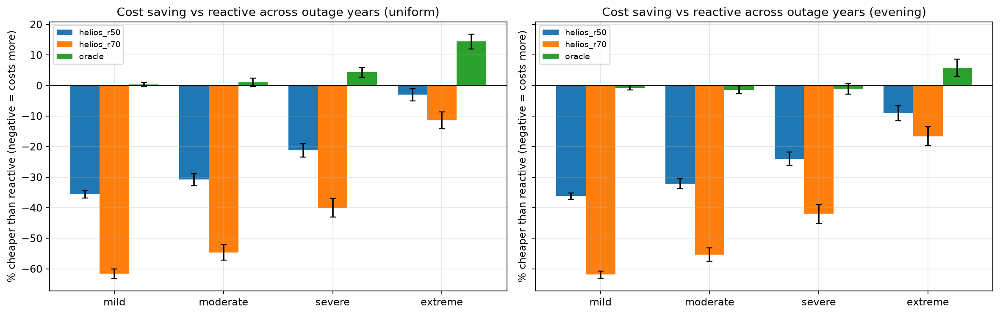

# HELIOS

**Can a smarter energy-management rule cut cost and generator use for a household on an unreliable grid? A simulation study for Uyo, Nigeria.**

[](https://colab.research.google.com/github/treasure-cd/helios/blob/main/notebooks/helios_experiment.ipynb)
[](https://colab.research.google.com/github/treasure-cd/helios/blob/main/notebooks/helios_part2.ipynb)



## The question

A household has grid power, solar panels, a battery and a backup generator. When should it charge, discharge, import from the grid, or start the generator? HELIOS runs the same household, solar resource and outage history through several control strategies and compares them on cost and generator runtime.

## Headline result

On a small system (3 kW PV, 2.5 kWh battery) under frequent outages, a simple forecast-free rule, **holding a 50% battery reserve only between 15:00 and 23:00**, cut annual operating cost by about **10%** and generator hours by **25-33%** across 20 outage years the rule was never tuned on. A fixed all-day reserve helps small batteries but loses money on large ones, and a learned outage predictor did not beat the simple rule.

Gains depend on grid quality and system size. When outages are mild, or the system is oversized, smarter control adds almost nothing.

## Results

Cost saving relative to the reactive baseline. Severe outages, 3 kW PV / 2.5 kWh battery, held-out seeds 10-29 (higher is better):

| Strategy | Evening-heavy outages | Uniform outages |
|---|---|---|
| Fixed 50% reserve (r50) | +7.7% | +11.0% |
| **Window 50% reserve (w50)** | **+9.6%** | **+11.5%** |
| Predictive, no grid top-up (q10) | +2.2% | +2.8% |
| Predictive (p10) | +1.8% | +1.1% |
| Oracle (perfect foresight, upper bound) | +25.8% | +27.5% |

For w50 that is roughly ₦44,000-₦51,000 a year against a reactive cost of about ₦440,000-₦460,000.

The value of foresight depends on system size. Oracle saving vs reactive, uniform outages:

| System | Mild | Moderate | Severe | Extreme |
|---|---|---|---|---|
| 5 kW / 5 kWh | 0.4% | 1.0% | 4.3% | 14.4% |
| 3 kW / 2.5 kWh | 6.9% | 15.3% | 27.8% | 41.3% |

No strategy left any demand unserved, so cost and generator hours are the comparison metrics.

## Key findings

1. Using the battery at all is the biggest saving: the naive strategy costs 120-340% more than reactive.
2. The value of coordination rises with grid unreliability and falls with system size.
3. A fixed reserve cuts generator hours but can raise cost, and it hurts on large batteries.
4. **The window reserve is the best deployable rule tested.** It beat reactive at every system size under severe outages and never lost more than 0.3% anywhere.
5. The window reserve helps equally when outage timing is random, so its saving does not come from predicting outages. My hypothesis is that reactive spends the battery on the evening peak and leaves it empty for late-night outages. This is untested.
6. The learned predictor only recovered hour-of-day structure, because the synthetic outage generator has no memory. Whether prediction helps depends on whether real outages have structure beyond time of day.

## Strategies

| Strategy | Behaviour |
|---|---|
| Naive | Solar to house, grid when up, generator when the grid drops. Battery unused. |
| Reactive | Surplus solar charges the battery; battery covers shortfalls whenever it can. The baseline everything is measured against. |
| Static reserve (r30/r50/r70) | Keeps a fixed battery reserve while the grid is up. |
| **Window reserve (w30/w50)** | Like reactive, but between 15:00 and 23:00 holds a reserve while the grid is up. |
| Predictive (p10/p13/q10) | Logistic-regression outage-risk model sets the reserve dynamically. |
| Oracle | Knows future outages. An upper bound, not a deployable strategy. |

All strategies use identical hardware, solar, demand and outage history.

## Data

| Input | Source |
|---|---|
| Solar irradiance | Real hourly data for Uyo from [NASA POWER](https://power.larc.nasa.gov/). Originally scoped for Lagos; Uyo was used because it is the target context. |
| Household demand | Synthetic hourly profile built from typical Nigerian household appliances |
| Grid outages | Synthetic: Poisson event counts with lognormal durations, in four scenarios (mild, moderate, severe, extreme) and two start-time patterns (uniform, evening-heavy) |

## Method in brief

- Hourly simulation engine with a per-hour energy-balance check. The run crashes if the numbers don't balance.
- Boundary tests for battery limits, generator rating, grid constraints and round-trip efficiency.
- 30 independent outage seeds per configuration, six hardware sizes, strategies compared on paired outage years.
- Strategy selected on seeds 0-9 and reported on seeds 10-29. The predictor was trained on separate seeds (100-114).

Full write-up: [REPORT.md](REPORT.md)

## Reproduce

```bash
git clone https://github.com/treasure-cd/REPO-NAME.git
cd REPO-NAME
pip install -r requirements.txt
python src/data/load_solar.py && python src/data/generate_demand.py
python src/run_sweep.py --sweep --seeds 30       # sizing sweep, uniform outages
python src/run_sweep.py --sweep --seeds 30 --pattern evening
python src/train_risk.py                         # outage-risk predictor
python src/main.py                               # tune/test tables
pytest src/tests
```

Results are written to `data/results/`. Or open the notebook in Colab with the badge above.

## Limitations

- Demand and outages are synthetic, and the evening pattern is an assumption, not measured Uyo data.
- Battery cost, generator fuel curve and efficiencies are estimates. Costs compare strategies; they are not real bills.
- The oracle is a heuristic, not an optimiser.
- One solar year; only the outage timeline varies between seeds.
- The headline system size was chosen after seeing the sweep because the base system is oversized. All six sizes are reported.
- Calendar ageing, generator maintenance and time-of-use tariffs are not modelled.
- Solar timestamps: UTC-to-local handling is unverified. <!-- confirm before publishing -->

## Scope

Built: data pipeline, simulation engine with tests, six strategy families, oracle, multi-seed and sizing experiments, outage-risk predictor, presentation, dashboard.
Not built: solar forecasting and anomaly detection. The core questions were answered without them.

## Future work

Real Uyo outage logs and meter data; a proper optimiser (dynamic programming or MPC) as the benchmark; solar forecasting; real tariffs and battery quotes with a cost sensitivity analysis; packaging the window rule as an inverter setting or installer advice tool.

## Acknowledgements

Solar data courtesy of the [NASA POWER Project](https://power.larc.nasa.gov/).

## Author

**Treasure Ani-Joseph**, Computer Science, University of Uyo. GitHub: [@treasure-cd](https://github.com/treasure-cd)
